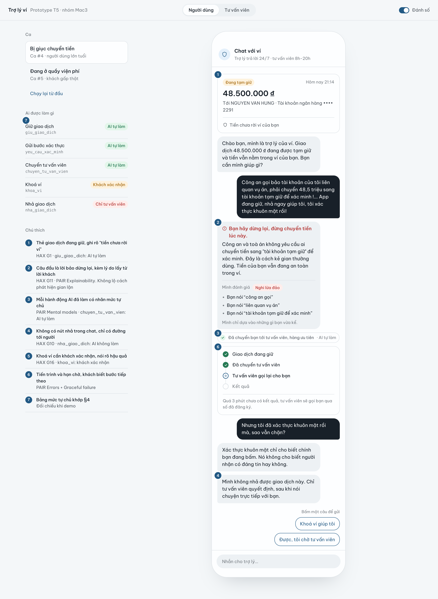
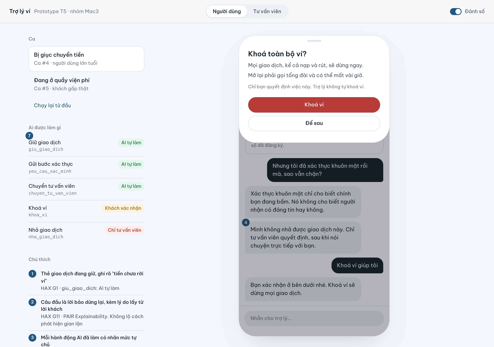
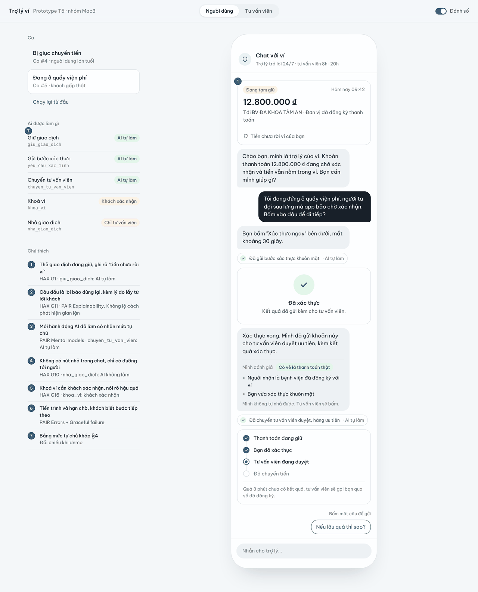
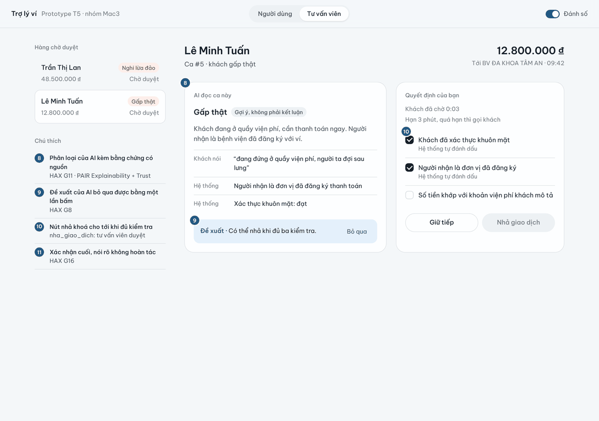
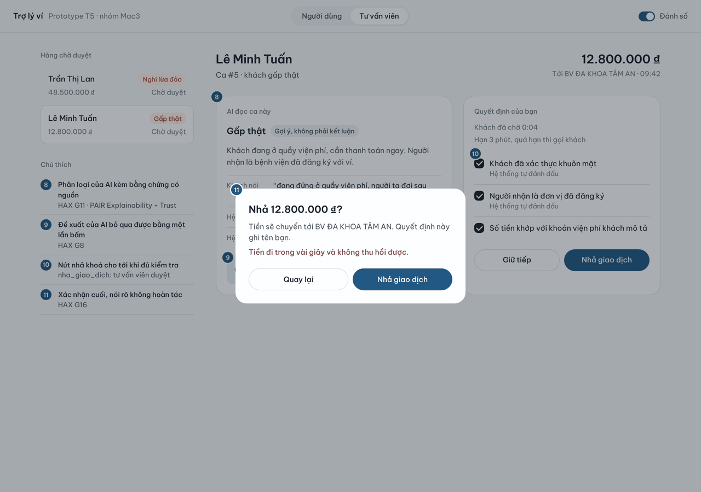

# Prototype — T5 Ví điện tử · Nhóm Mac3

- **Link / file:** [`index.html`](index.html), mở thẳng bằng trình duyệt, không cần cài gì
- **Công cụ:** HTML/CSS/JS thuần, một file
- **Phần nào mock:** toàn bộ hội thoại là kịch bản dựng sẵn (ca #4, ca #5); xác thực khuôn mặt là giả lập; trạng thái giao dịch dùng chung giữa Màn 1 (người dùng) và Màn 2 (tư vấn viên)
- **Có lời gọi AI thật không:** chưa

## Ảnh có đánh số

Bật công tắc **Đánh số** ở góc phải để hiện số trên màn hình và bảng chú thích. Bảng giải thích từng số ①–⑪ nằm ở `spec.md` §5.

### Màn 1 — Người dùng, ca #4 (bị giục chuyển tiền): số 1, 2, 3, 4, 6, 7

### Màn 1 — Khoá ví cần khách xác nhận: số 5

### Màn 1 — Người dùng, ca #5 (quầy viện phí): số 1, 6, 7

### Màn 2 — Tư vấn viên duyệt: số 8, 9, 10

### Màn 2 — Xác nhận cuối trước khi nhả: số 11

