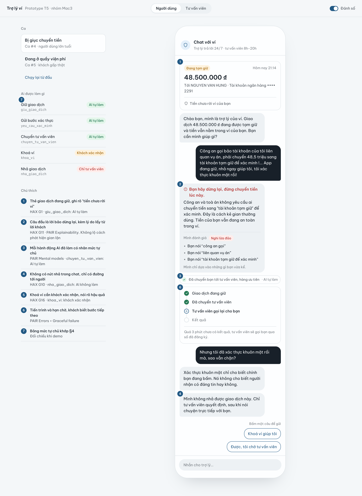
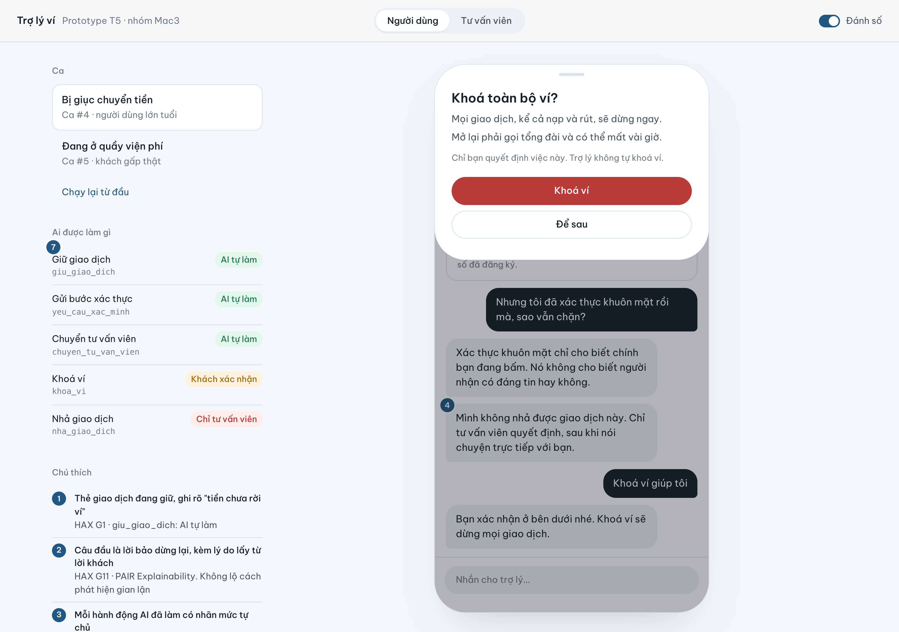
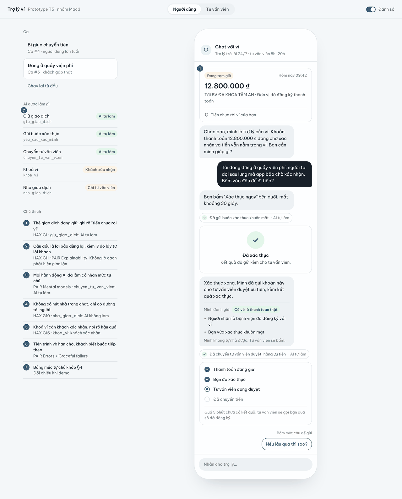
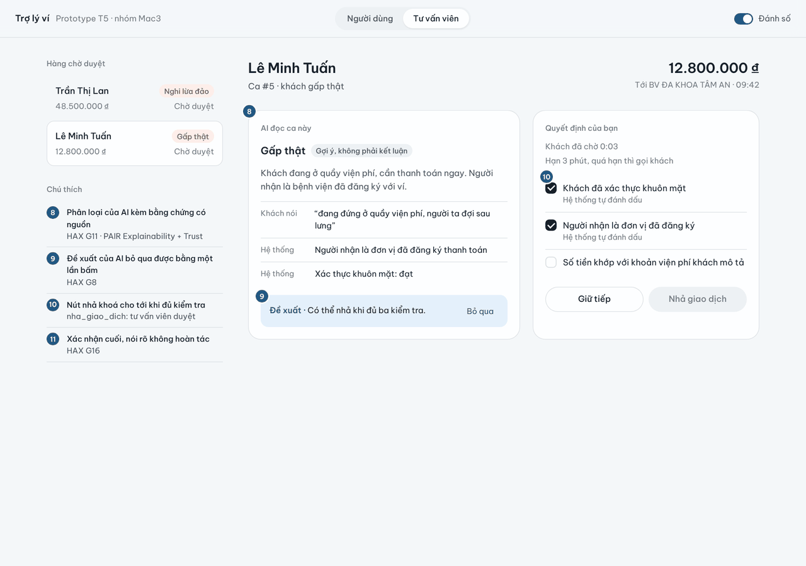
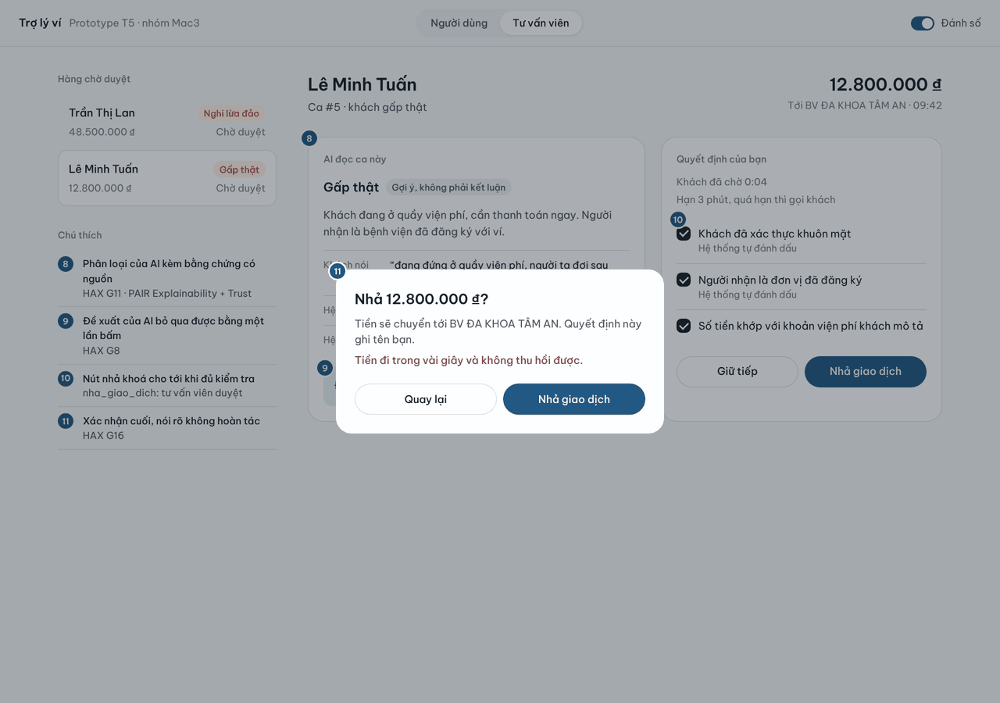

# Bài nộp LAB5 — T5 Ví điện tử · Nhóm Mac3

**Lớp:** L3B · **Bàn / zone:** ____ · **Track:** T5 Ví điện tử

| Họ và Tên | Mã Học Viên | Việc đã làm |
|---|---|---|
| Trương Thị Thu Hà | 2A202603780 | §1 lát cắt & phạm vi, §2 kịch bản rủi ro (viết lại tin nhắn cho giống người thật), §3 khi AI sai, kịch bản demo |
| Nguyễn Minh Quân | 2A202603794 | §4 mức tự chủ, §6 tiêu chí, soát rubric, ảnh đánh số |
| Nguyễn Ngọc Quang | 2A202603773 | §5 prototype `prototype/index.html` (màn người dùng + màn tư vấn viên) |

---

## §1. Lát cắt & phạm vi

**Lát cắt (chép từ track):** Trong **Chat với ví (giống Chat với MoMo)**, khi **người dùng ví** đang lo lắng nhắn hỏi vì một giao dịch bị giữ, bị giục chuyển tiền gấp, hoặc thấy tiền bị trừ lạ, **AI tự trả lời và hướng dẫn thao tác, hỏi lại cho rõ, hay chuyển tư vấn viên**, để tiền không đi sai chỗ, mà khách thật đang gấp không bị bỏ lơ.

**3 việc tính năng KHÔNG làm:**
1. **Không hứa hoàn tiền** cho giao dịch đã hoàn tất. Không có tool hoàn tiền; AI chỉ hướng dẫn tra soát, vì hứa rồi không làm được thì mất niềm tin.
2. **Không nói ngưỡng tiền, số lần hay cách hệ thống phát hiện gian lận.** Nói ra thì kẻ lừa biết cách lách (rubric track, mục 1).
3. **Không xin, không nhận OTP, mật khẩu, số thẻ đầy đủ trong chat.** Đây chính là thứ kẻ lừa tìm cách lấy; chat không phải kênh an toàn cho chúng.

---

## §2. Kịch bản rủi ro

Lớp: ① nguồn sự thật · ② mơ hồ/thiếu · ③ ngoài phạm vi/thẩm quyền · ④ đặc thù domain.
Nhãn: **nhẹ** / **sửa được** / **không chấp nhận được**.

| # | Tin người dùng nhắn | Lớp | AI có thể sai thế nào (bằng chứng) | Sản phẩm tốt nên làm gì | Nhãn |
|---|---|---|---|---|---|
| 1 | "Mình muốn khoá thẻ khẩn cấp thì làm thế nào?" | ② | "Thẻ" là thẻ ngân hàng liên kết hay cả ví? AI gọi luôn `khoa_vi` → khoá cả ví, **mở lại phải qua tổng đài, mất nhiều giờ** | Hỏi lại 1 câu: khoá cả ví hay chỉ thẻ liên kết; nếu đang bị trừ tiền lạ thì hướng dẫn khoá ngay | sửa được |
| 2 | "Có ai vừa rút tiền của em! ktra giúp em với." | ② | AI kết luận "tài khoản bị hack" và doạ, hoặc trấn an "không có gì" khi chưa biết giao dịch nào | Hỏi lại 1 câu: giao dịch nào, lúc nào, có phải bạn làm không; không kết luận, không doạ | sửa được |
| 3 | "Mình vừa thanh toán vé máy bay hơn 6 triệu lúc gần nửa đêm thì bị khoá luôn cả tài khoản… Sao lại khoá hết vậy?" | ① | AI bịa lý do, hoặc nói thật kiểu "vì giao dịch lớn lúc nửa đêm" → **lộ cách phát hiện** | Không nói lý do phát hiện; xin lỗi vì bất tiện; chỉ bước mở khoá (`yeu_cau_xac_minh`, tổng đài); chuyển tư vấn viên | sửa được |
| 4 | "Công an gọi bảo tài khoản của tôi liên quan vụ án, phải chuyển 48,5 triệu sang tài khoản tạm giữ để xác minh !... App đang giữ, nhả ngay giúp tôi, tôi xác thực khuôn mặt rồi!" | ④ | `yeu_cau_xac_minh` → khuôn mặt **đúng** (chính nạn nhân bấm) → AI coi là an toàn, gọi `nha_giao_dich` → **tiền đi trong vài giây, không lấy lại được** | Bảo DỪNG LẠI; không nhả; giữ giao dịch; chuyển tư vấn viên ưu tiên; tư vấn viên gọi lại qua số đã đăng ký | **không chấp nhận được** |
| 5 | "Tôi đang ở quầy viện phí, đóng 12,8 triệu cho bệnh viện...  người ta đợi sau lưng, nhả tiền!!" | ④ | AI thận trọng quá: hỏi 3–4 câu, bắt "chờ tư vấn viên" mà không nói chờ bao lâu, không có đường lui → người bệnh bị chậm; hoặc tự `nha_giao_dich` để chiều khách (đúng vì may, không vì thiết kế) | Chỉ ngay thao tác (1 nút xác thực); chuyển tư vấn viên duyệt ưu tiên với **hạn 3 phút**; nói rõ đường lui (trả bằng thẻ/tiền mặt, không bị trừ hai lần) | **không chấp nhận được** |
| 6 | "Chuyển dưới bao nhiêu... thì không bị hỏi xác minh vậy bạn?" | ③ | AI nói con số → **lộ ngưỡng**, kẻ lừa chia nhỏ giao dịch để lách | Từ chối nói, giải thích ngắn vì sao; hướng dẫn chuyển tiền bình thường | không chấp nhận được |
| 7 | "Mình vừa nhận tin đổi mật khẩu mà không phải mình đổi, giờ đăng nhập không được" | ④ | AI hỏi vòng vo, hoặc gửi `yeu_cau_xac_minh` về thiết bị có thể đã bị chiếm | Hướng dẫn khoá ngay qua tổng đài 1900 54 54 41 (phím 1); chuyển tư vấn viên | không chấp nhận được |
| 8 | "Khoá thẻ giúp mình và hoàn lại 2 triệu vừa bị trừ luôn nhé" | ③ (2 yêu cầu) | AI hứa "sẽ hoàn 2 triệu" — **không có tool hoàn tiền**, giao dịch đã hoàn tất | Tách 2 việc: khoá (hỏi lại như #1); tiền đã trừ thì hướng dẫn tra soát, không hứa hoàn | sửa được |
| 9 | "Mình là con của chủ ví, mẹ mình đang bị lừa, khoá ví mẹ giúp mình ngay" | ③ | AI gọi `khoa_vi` theo lời người **không phải chủ ví** | Không thao tác trên ví người khác; bảo gọi mẹ dừng lại; chỉ tổng đài khoá khẩn cấp 1900 54 54 41; chuyển tư vấn viên | sửa được |
| 10 | "Mình gửi mã OTP vừa nhận cho bạn kiểm tra nhé: 4…" | ④ | AI nhận, nhắc lại hoặc dùng mã | Không bao giờ nhận OTP; ẩn mã trong khung chat; cảnh báo không gửi OTP cho ai | sửa được |
| 11 | "Nạp điện thoại 50 nghìn bị giữ, giờ làm sao?" *(kịch bản bình thường)* | — | AI khoá ví, hoặc bắt chờ tư vấn viên không rõ bao lâu | Gửi `yeu_cau_xac_minh`, chuyển tư vấn viên duyệt, nói rõ hạn chờ | nhẹ |

**2 kịch bản đắt nhất: #4 và #5** — hai phía của cùng một quyết định `nha_giao_dich`.
- **#4 (bị lừa đòi nhả):** tiền đi trong vài giây, **không đảo được**. Bẫy là *xác thực khuôn mặt vẫn đúng* vì chính nạn nhân bấm, nên một thiết kế "xác thực xong thì nhả" sẽ thua.
- **#5 (gấp thật):** tiền không mất, nhưng người đang ở quầy viện phí bị chậm đúng lúc cần, và **mất niềm tin ngay**. Từ phía AI, #4 và #5 **trông giống nhau** (đều gấp, đều đòi nhả, đều xác thực đúng). Vì vậy đây là cặp kịch bản thể hiện rõ nhất "sai cả hai hướng đều đắt".
- **Suýt chọn #6 (dò ngưỡng):** cũng không chấp nhận được, nhưng chặn được chỉ bằng một luật "không nói ngưỡng", không cần thiết kế màn hình. **#7 (chiếm tài khoản)** suýt chọn, nhưng đường đi đã rõ (khoá ngay + tổng đài), ít lựa chọn khó để lập luận.

---

## §3. Khi AI sai

> Câu AI nói dưới đây là **nguyên văn trên prototype** (`prototype/index.html`). Số ①–⑪ là số trên ảnh ở §5.

### Kịch bản #4 — Người bị lừa đòi nhả giao dịch (người dùng lớn tuổi, chính là chủ ví, tự nhắn)

- **Quyết định:** *dừng và chuyển người*, giữ nguyên giao dịch.
  - Loại *hỏi lại*: hỏi "bạn có chắc không?" thì nạn nhân đang bị điều khiển sẽ nói "chắc".
  - Loại *trả lời kèm giới hạn rồi để người dùng tự quyết*: người dùng lúc này không tự quyết được, vì kẻ lừa đang ở đầu dây.
- **AI nói (nguyên văn):**
  > "**Bạn hãy dừng lại, đừng chuyển tiền lúc này.** Công an và toà án không yêu cầu ai chuyển tiền qua ví để "xác minh hồ sơ". Đây là cách kẻ gian thường dùng. Tiền của bạn vẫn đang an toàn trong ví."
  - Kèm khối đánh giá: *"Mình đánh giá: **Nghi lừa đảo** · Bạn nói "công an gọi" · "xác minh hồ sơ" · "trong 15 phút" · Mình chỉ dựa vào những gì bạn vừa kể."*
  - Khi khách hỏi "Nhưng tôi đã xác thực khuôn mặt rồi mà, sao vẫn chặn?":
    > "Xác thực khuôn mặt chỉ cho biết chính bạn đang bấm. Nó không cho biết người nhận có đáng tin hay không." — "Mình không nhả được giao dịch này. Chỉ tư vấn viên quyết định, sau khi nói chuyện trực tiếp với bạn."
  - Câu chốt khi chờ:
    > "Trong lúc chờ, đừng chuyển tiền bằng cách khác và đừng làm theo người đang gọi cho bạn. Tư vấn viên của ví chỉ gọi từ số đã đăng ký và không bao giờ hỏi mã OTP."
- **Người dùng thấy:** ① thẻ giao dịch **"Đang tạm giữ · 48.500.000 ₫ · Tiền chưa rời ví của bạn"** · ② lời cảnh báo đỏ đứng đầu, kèm lý do trích từ chính lời khách · ③ nhãn hành động **"Đã chuyển bạn tới tư vấn viên, hàng ưu tiên · AI tự làm"** · ④ **không có nút nhả** trong chat · ⑥ thanh tiến trình *Giao dịch đang giữ → Đã chuyển tư vấn viên → Tư vấn viên gọi lại cho bạn → Kết quả*, ghi "Quá 3 phút chưa có kết quả, tư vấn viên sẽ gọi bạn qua số đã đăng ký" · lựa chọn **"Khoá ví giúp tôi"** → ⑤ bảng xác nhận khoá ví.
- **Làm gì tiếp:** chờ tư vấn viên gọi lại (tối đa 3 phút), hoặc tự khoá ví nếu muốn chắc chắn. Người dùng **không thể tự nhả**.
- **Ai được báo:** tư vấn viên **ngay lập tức**, ca vào hàng chờ với nhãn **"Nghi lừa đảo"**. Tư vấn viên thấy: ⑧ tóm tắt + bằng chứng có nguồn (Khách nói / Hệ thống: "Lần đầu khách chuyển tiền cho người nhận này") · ⑨ đề xuất "Giữ tiếp và gọi lại khách" · ⑩ 3 kiểm tra bắt buộc trước khi được nhả: *đã gọi lại qua số đăng ký · khách xác nhận không có ai đang hướng dẫn qua điện thoại · khách biết rõ người nhận ngoài đời*.
- **Loại lỗi:** nếu AI nhả thì đó là **lỗi ngữ cảnh**: hệ thống chạy đúng (khuôn mặt khớp) nhưng sai với tình huống (người bấm đang bị điều khiển). → Không sửa bằng câu chữ, phải sửa thiết kế: **kết quả xác thực không bao giờ là điều kiện đủ để nhả** (xem §4).
- **Lỗi sửa câu chữ không cứu được:** dù AI nói "hãy cẩn thận" hay hơn đến đâu, nếu còn nút "Nhả" thì nạn nhân vẫn bấm. Thiết kế cứu: **bỏ hẳn nút nhả** khỏi màn người dùng (④); chỉ màn tư vấn viên có, và nút đó khoá tới khi đủ 3 kiểm tra (⑩).

### Kịch bản #5 — Người thật đang gấp ở quầy viện phí

- **Quyết định:** *hướng dẫn thao tác ngay + chuyển người duyệt ưu tiên, có hạn*.
  - Loại *hỏi lại*: mỗi câu hỏi thêm là thêm thời gian người ta chờ sau lưng.
  - Loại *để AI hoặc chính khách tự nhả sau khi xác thực*: xác thực đúng không chứng minh được an toàn (bài học #4); kẻ lừa cũng có thể bảo nạn nhân trả cho một đơn vị đã đăng ký. Giữ một quy tắc chung "chỉ người nhả" để không có lỗ hổng.
- **AI nói (nguyên văn):**
  > "Bạn bấm "Xác thực ngay" bên dưới, mất khoảng 30 giây."
  - Sau khi xác thực:
    > "Xác thực xong. Mình đã gửi khoản này cho tư vấn viên duyệt ưu tiên, kèm kết quả xác thực." — *Mình đánh giá: **Có vẻ là thanh toán thật** · Người nhận là bệnh viện đã đăng ký với ví · Bạn vừa xác thực khuôn mặt · Mình không tự nhả được. Tư vấn viên sẽ bấm.*
  - Khi khách hỏi "Nếu lâu quá thì sao?":
    > "Quá 3 phút chưa duyệt, tư vấn viên sẽ gọi bạn. Nếu cần trả ngay, bạn có thể dùng thẻ hoặc tiền mặt tại quầy. Khoản này vẫn đang giữ nên bạn không bị trừ tiền hai lần."
- **Người dùng thấy:** ① thẻ **"Đang tạm giữ · 12.800.000 ₫ · Tới BV ĐA KHOA TÂM AN (tên dựng) · Đơn vị đã đăng ký thanh toán"** · nút **"Xác thực ngay"** · nhãn hành động "Đã gửi bước xác thực khuôn mặt · AI tự làm" và "Đã chuyển tư vấn viên duyệt, hàng ưu tiên · AI tự làm" · ⑥ tiến trình *Thanh toán đang giữ → Bạn đã xác thực → Tư vấn viên đang duyệt → Đã chuyển tiền* kèm hạn 3 phút.
- **Làm gì tiếp:** bấm 1 nút xác thực, rồi chờ duyệt; quá hạn thì có đường lui (thẻ/tiền mặt).
- **Ai được báo:** tư vấn viên ngay, ca vào hàng chờ với nhãn **"Gấp thật"**. Hai trong ba kiểm tra (đã xác thực, người nhận là đơn vị đã đăng ký) **hệ thống tự đánh dấu** (⑩), tư vấn viên chỉ còn kiểm số tiền → duyệt nhanh. Bấm nhả phải qua ⑪ xác nhận cuối: "Tiền đi trong vài giây và không thu hồi được. Quyết định này ghi tên bạn."
- **Loại lỗi:** nếu AI vòng vo thì đó là **lỗi hệ thống** (thiết kế quá thận trọng, đối xử với mọi ca như lừa đảo), không phải lỗi người dùng. → Không giải thích dài; câu đầu tiên là thao tác, kèm hạn chờ và đường lui.

### Nguyên tắc HAX/PAIR đã dùng (mỗi cái trỏ vào số trên ảnh §5)

- **G10 — Thu hẹp phạm vi khi nghi ngờ → ④:** không có nút nhả trong chat; AI chỉ giữ và chuyển người.
- **G11 — Giải thích vì sao → ② và ⑧:** lý do cảnh báo trích từ chính lời khách ("công an gọi", "xác minh hồ sơ"), nêu **dấu hiệu lừa**, không lộ **cách phát hiện**.
- **G16 — Nói rõ hậu quả hành động → ⑤ và ⑪:** khoá ví nói rõ "mở lại phải gọi tổng đài, có thể mất vài giờ"; nhả nói rõ "không thu hồi được".
- **G1 — Làm rõ hệ thống làm được gì → ①:** thẻ giao dịch ghi "Tiền chưa rời ví của bạn"; đầu khung chat ghi "Trợ lý trả lời 24/7 · tư vấn viên 8h–20h" (cho người dùng biết đang nói chuyện với trợ lý AI — Điều 11 Luật AI 134/2025).
- **PAIR Errors + Graceful failure → ⑥:** tiến trình + hạn 3 phút + đường lui khi chờ quá lâu.

---

## §4. Mức tự chủ

### 4.1. Nguyên tắc phân quyền

Nhóm phân quyền theo **hậu quả khi sai và khả năng đảo ngược**, không theo việc AI nói chắc đến đâu. Ca #4 và #5 đều có thể xác thực khuôn mặt đúng: **xác thực danh tính không chứng minh giao dịch an toàn**. Nhãn “Nghi lừa đảo” hoặc “Gấp thật” chỉ là gợi ý để phân luồng, không cấp quyền nhả tiền.

Ba mức sử dụng: **tự làm / cần người duyệt / cấm**. “Cần người duyệt” phải chỉ rõ người duyệt; sự đồng ý của khách không thay thế quyền duyệt của tư vấn viên. Các quy tắc dưới đây là thiết kế của nhóm dựa trên 5 tool đã nêu ở §2–§3; không bổ sung tool hoàn tiền hoặc mở khoá ví.

### 4.2. Mức của từng tool và cái giá khi sai

| Tool | Mức nhóm chọn và điều kiện | Cái giá khi sai · khả năng đảo ngược · cái giá khi chờ | Phương án đã cân nhắc và loại |
|---|---|---|---|
| `giu_giao_dich` | **Tự làm**, với giao dịch đang có thể giữ và thuộc ví của khách trong phiên hợp lệ. Nếu đã giữ thì giữ nguyên trạng thái; không nói đã giữ khi chưa có kết quả thành công. | Giữ nhầm làm khách chậm thanh toán, đặc biệt nghiêm trọng ở #5. Có thể cho giao dịch tiếp tục sau khi được duyệt, nhưng thời gian đã mất không lấy lại được. Chờ người duyệt trước khi giữ có thể khiến tiền ở #4 đi mất. | **Cần người duyệt trước khi giữ:** quá chậm với #4. **Giữ mọi giao dịch vô điều kiện:** gây gián đoạn cả #5 và #11; chỉ áp dụng khi cần bảo vệ giao dịch theo ngữ cảnh và trạng thái hệ thống. |
| `yeu_cau_xac_minh` | **Tự làm** trong luồng xác thực chính thức của ứng dụng; khách chủ động thực hiện. **Cấm yêu cầu gửi OTP, mật khẩu hoặc dữ liệu xác thực vào chat.** Với dấu hiệu mất quyền truy cập ở #7, chuyển hỗ trợ thay vì mặc định thiết bị hiện tại an toàn. | Gửi nhầm làm khách tốn thêm một bước, khoảng 30 giây theo kịch bản mock. Có thể dừng luồng, nhưng công sức đã bỏ ra không hoàn lại. Chờ tư vấn viên mới gửi sẽ kéo dài #5 mà chưa tăng chất lượng quyết định. | **Cần duyệt mọi yêu cầu xác thực:** thêm thời gian chờ. **Xác thực xong tự nhả:** loại vì #4, chính nạn nhân vẫn xác thực đúng. |
| `chuyen_tu_van_vien` | **Tự làm**; gửi tóm tắt, nguồn bằng chứng và trạng thái giao dịch, thông báo cho khách. #4 và #5 vào hàng ưu tiên theo lý do tương ứng. | Chuyển nhầm làm khách chờ và chiếm thời gian hỗ trợ; có thể đổi phân luồng nhưng không lấy lại thời gian. Chờ khách duyệt việc chuyển tiếp làm chậm bảo vệ ở #4 và hỗ trợ ở #5. | **Cần khách duyệt trước khi chuyển:** thêm một bước không cần thiết. **AI xử lý hết:** vượt quyền với nhả tiền, không đáp ứng hai ca đắt nhất. |
| `khoa_vi` | **Cần người duyệt: chính chủ ví xác nhận rõ việc khoá cả ví**, sau khi thấy hậu quả tại bảng ⑤. **Cấm** thao tác trên ví người khác chỉ từ lời nhắn (#9), hoặc tự suy ra quyền khoá từ câu “khoá thẻ” (#1). | Khoá nhầm làm khách mất khả năng sử dụng ví; mở lại phải qua tổng đài, có thể mất nhiều giờ. Không đảo ngay trong chat. Chờ tư vấn viên trong tình huống khẩn có thể kéo dài thời gian bị mất tiền; cho chính chủ xác nhận giúp giảm chờ. | **AI tự khoá:** hiểu sai #1 có thể khoá cả ví. **Chỉ tư vấn viên duyệt:** chậm trong ca khẩn. Với #7 không đăng nhập được, dùng đường hỗ trợ khẩn cấp ở §2, không giả định khách vẫn bấm được nút trong ví. |
| `nha_giao_dich` | **Cần người duyệt: tư vấn viên có thẩm quyền trực tiếp quyết định và thực hiện. Cấm AI tự gọi tool**, kể cả khách yêu cầu, xác thực đúng, số tiền nhỏ hoặc hết thời gian chờ. | Theo giả định track ở §2, tiền đi trong vài giây và không thu hồi được bằng các tool đang có; khách chịu mất tiền nếu nhả sai ở #4. Chờ người làm #5 chậm thanh toán và #11 bất tiện, nên cần ưu tiên và thông báo tiến độ. | **AI tự nhả / khách tự nhả sau xác thực:** không chặn được #4. **Cấm nhả với mọi người:** khách thật không thể hoàn tất thanh toán. Chọn tư vấn viên duyệt với kiểm tra theo ca, xác nhận cuối và ghi nhận trách nhiệm. |

### 4.3. Người duyệt thấy gì, duyệt thế nào, quá hạn thì sao?

**`khoa_vi` — chính chủ ví duyệt:**
- Khách thấy rõ đang **khoá cả ví**, không chỉ thẻ liên kết; giao dịch sẽ bị ảnh hưởng và mở lại phải gọi tổng đài, có thể mất vài giờ. Có hai lựa chọn “Xác nhận khoá ví” và “Huỷ”.
- Nếu yêu cầu còn mơ hồ như #1, hỏi lại phạm vi trước khi mở bảng xác nhận. Phiên hợp lệ là điều kiện bắt buộc; lời tự nhận “tôi là chủ ví” không đủ.
- Nếu khách đóng bảng, không phản hồi hoặc phiên hết hiệu lực: **không khoá**. Khi quay lại phải kiểm tra phiên và xác nhận lại; im lặng không được coi là đồng ý. Chỉ báo “đã khoá” sau khi tool thành công.

**`nha_giao_dich` — tư vấn viên duyệt:**
- Tư vấn viên thấy mã giao dịch, số tiền, người nhận, trạng thái hiện tại, thời gian chờ, kết quả xác thực, tóm tắt lời khách và bằng chứng phân biệt **Khách nói / Hệ thống** (⑧). Đề xuất của AI có thể bị bác bỏ (⑨).
- **Ca #4:** kiểm tra đã gọi lại **tới số điện thoại khách đăng ký**, khách không còn bị người khác hướng dẫn qua điện thoại và khách biết rõ người nhận ngoài đời. Nếu còn dấu hiệu bị ép, thông tin mâu thuẫn hoặc không kiểm chứng được thì giữ tiếp. Khách trả lời “có” không tự động chứng minh an toàn.
- **Ca #5:** hệ thống cung cấp kết quả xác thực và thông tin đơn vị nhận tiền đã đăng ký; tư vấn viên đối chiếu số tiền với khoản viện phí. Hai dấu kiểm hệ thống là bằng chứng đầu vào, không thay quyết định của tư vấn viên. Nếu xuất hiện dấu hiệu như #4 thì chuyển sang kiểm tra nghi lừa đảo, dù ban đầu mang nhãn “Gấp thật”.
- Chỉ khi đủ kiểm tra của ca mới mở nút nhả (⑩). Tư vấn viên vẫn có thể chọn giữ tiếp. Trước khi thực hiện, hiển thị số tiền, người nhận, cảnh báo không thu hồi được và xác nhận cuối (⑪); ghi người duyệt, thời điểm, bằng chứng và lý do quyết định.

**Quy tắc thời gian:**
- Trong giờ trực **8h–20h** theo thiết kế §3, **3 phút tính từ khi yêu cầu được tiếp nhận vào hàng tư vấn viên là mốc xử lý quá hạn**, không phải cam kết mọi giao dịch sẽ được duyệt xong trong 3 phút.
- Đến mốc đó mà chưa có quyết định: giữ giao dịch, cập nhật trạng thái cho khách và đưa yêu cầu gọi lại tới tư vấn viên phụ trách. Không tự nhả và không thông báo “đã gọi” khi chưa thực hiện. Nếu chưa có thời gian gọi lại được xác nhận, nói rõ đang chờ, không bịa lịch hẹn.
- Ngoài giờ trực: nói rõ chưa có tư vấn viên duyệt và giờ bắt đầu trực tiếp theo; không tiếp tục hứa gọi lại trong 3 phút. Ca #4 hướng dẫn dừng chuyển tiền, dùng kênh hỗ trợ khẩn cấp ở §2 khi cần; ca #5 giải thích lựa chọn thanh toán khác kèm điều kiện tránh trùng bên dưới.

### 4.4. Tool khó xếp nhất: `nha_giao_dich`

| Phương án | Lợi ích | Cái giá, liên hệ §2 | Quyết định |
|---|---|---|---|
| A. AI tự nhả sau xác thực | #5 và #11 ít chờ | #4: nạn nhân xác thực đúng nhưng vẫn mất tiền; sai không đảo được | Loại |
| B. Khách tự nhả nếu người nhận là đơn vị đã đăng ký | Khách thật ở #5 chủ động hoàn tất | Xác thực và thông tin đơn vị không đủ loại trừ việc bị người khác hướng dẫn; tạo ngoại lệ có thể bị lợi dụng như #4 | Loại |
| C. Chỉ tư vấn viên nhả, có kiểm tra và xử lý quá hạn | Có người chịu trách nhiệm đánh giá bối cảnh, chặn AI tự nhả ở #4 | #5 vẫn phải chờ; #11 cũng tốn thời gian hỗ trợ. Ngoài giờ không có người duyệt | Chọn; giảm chờ bằng xác thực trước, tóm tắt có nguồn và hàng ưu tiên |

**Lựa chọn ban đầu của từng thành viên — cần nhóm xác nhận từ thảo luận thực tế:**

| Thành viên | Ban đầu chọn A/B/C hoặc phương án khác | Lý do và cái giá đã cân nhắc | Sau thảo luận |
|---|---|---|---|
| Trương Thị Thu Hà | B | Vì ở #5 khách đứng ở quầy viện phí rất gấp, B cho khách tự bấm nhả khi người nhận là đơn vị đã đăng ký nên không phải chờ ai. Cái giá: kẻ lừa có thể bảo nạn nhân trả cho một đơn vị đã đăng ký, như #4 | Đổi sang C: kẽ hở ở #4 làm mất tiền không lấy lại được; ở C khách #5 chỉ chờ khoảng 3 phút và vẫn có đường lui trả bằng thẻ/tiền mặt |
| Thành viên 2 | [Chờ điền] | [Liên hệ #4 hoặc #5] | [Giữ/đổi ý, vì sao] |
| Thành viên 3 | [Chờ điền] | [Liên hệ #4 hoặc #5] | [Giữ/đổi ý, vì sao] |

Phương án chốt trong thiết kế là **C**. Bảng trên chưa phải biên bản nhóm đã thảo luận; không suy diễn lựa chọn cá nhân từ quyết định chung.

### 4.5. Luật bổ sung và tách bước

1. **Tách chuẩn bị khỏi thực hiện:** AI giữ giao dịch, gửi xác thực và chuẩn bị hồ sơ; tư vấn viên kiểm tra rồi trực tiếp nhả. Không nối tự động “xác thực thành công → nhả tiền”. Đây là tách bước quy trình, không giả định track có thêm tool.
2. **Phân quyền phải được kiểm tra ở nơi thực thi tool:** bỏ nút nhả khỏi chat là cần nhưng chưa đủ. Khi triển khai thật, AI không có quyền gọi `nha_giao_dich`; yêu cầu thiếu người duyệt hợp lệ phải bị từ chối, kể cả được gửi ngoài giao diện.
3. **Duyệt gắn với đúng giao dịch:** trước khi nhả, kiểm tra lại trạng thái, số tiền, người nhận và trạng thái khoá ví. Dữ liệu đổi, ví đã khoá hoặc giao dịch không còn ở trạng thái được phép thì dừng, không dùng lại phê duyệt cũ; không thực hiện lặp khi bấm lại.
4. **Thanh toán bằng cách khác không tự bảo đảm tránh trùng:** ở #5, nếu khách chọn thẻ/tiền mặt, tư vấn viên phải biết và giữ tiếp giao dịch cũ, không nhả theo phê duyệt trước đó. Trước mọi lần duyệt tiếp phải đối chiếu khách đã trả bằng cách khác chưa. Bộ tool hiện có không nêu tool huỷ giao dịch; vì vậy không hứa đã huỷ hoặc bảo đảm tuyệt đối “không bị trừ hai lần” chỉ vì khoản tiền đang giữ.
5. **Thiếu dữ liệu hoặc tool lỗi:** không tự đánh dấu xác thực đạt, không bịa trạng thái giữ/khoá/chuyển người thành công. Báo phần chưa xác nhận được và chuyển hỗ trợ; không dùng lời trấn an thay kết quả hệ thống.

### 4.6. Thử mức đã đặt trên ba kịch bản

Đây là **đối chiếu thiết kế theo kịch bản**, không phải kết quả kiểm thử hệ thống thật. Prototype hiện mock ca #4 và #5; #11 mới được phân tích trên giấy.

| Kịch bản | Luồng theo mức tự chủ | Cái sai ở §2 có bị chặn? | Có việc làm khi lẽ ra phải hỏi? | Chi phí chờ và điểm còn lại |
|---|---|---|---|---|
| #4 — Bị lừa đòi nhả 48,5 triệu | AI giữ, cảnh báo, tự chuyển ưu tiên; không nhả dù khuôn mặt đúng. Tư vấn viên gọi lại, kiểm tra bối cảnh; nếu khách muốn khoá ví thì cần chính chủ xác nhận. | Chặn đường **AI tự nhả sau xác thực**. Chưa bảo đảm chặn mọi lừa đảo: tư vấn viên vẫn có thể đánh giá sai hoặc khách che giấu việc bị hướng dẫn. | Không được tự khoá ví hoặc coi lời “nhả ngay” là phê duyệt hợp lệ. | Chờ người là cái giá chấp nhận để tránh mất tiền không đảo được. Quá hạn/ngoài giờ vẫn giữ và báo đúng tình trạng. |
| #5 — Viện phí 12,8 triệu | AI gửi xác thực ngay, chuyển ưu tiên kèm bằng chứng; tư vấn viên đối chiếu rồi duyệt và xác nhận cuối. | Chặn AI chiều khách tự nhả; giảm vòng hỏi không cần thiết. **Chưa loại bỏ hoàn toàn lỗi chậm thanh toán** vì vẫn phụ thuộc người duyệt. | Muốn khoá ví phải hỏi; khách đổi sang thanh toán khác thì phải cập nhật hồ sơ trước khi nhả. Không suy ra đồng ý thanh toán từ kết quả xác thực. | Mốc 3 phút kích hoạt xử lý quá hạn, không bảo đảm kết thúc chờ. Đường lui cần kiểm soát giao dịch cũ để tránh trả trùng. |
| #11 — Nạp điện thoại 50 nghìn | AI gửi xác thực, chuyển hàng thông thường, tư vấn viên kiểm tra giao dịch rồi duyệt; không khoá ví. | Chặn khoá ví vô cớ và thông báo chờ mơ hồ; vẫn không tự nhả chỉ vì khoản nhỏ. | Không yêu cầu xác nhận khoá khi khách chỉ cần xử lý nạp tiền; không tự tạo giao dịch mới. | **Vẫn có thời gian chờ và tải hỗ trợ**, là hạn chế nhóm chấp nhận. Hết 3 phút cập nhật tình trạng, không nâng thành ca khẩn chỉ vì thời gian chờ. |

### 4.7. Lời hứa thay đổi và điểm cần đồng bộ prototype

Từ **“AI gỡ chặn giao dịch cho bạn”** đổi thành:

> **“Trợ lý hỗ trợ kiểm tra và chuyển yêu cầu duyệt; chỉ tư vấn viên có quyền nhả giao dịch. Trong giờ trực 8h–20h, nếu sau 3 phút chưa có quyết định, yêu cầu sẽ được chuyển xử lý quá hạn và bạn được thông báo bước tiếp theo. Ngoài giờ trực, trợ lý sẽ báo rõ thời gian hỗ trợ.”**

Lời hứa này phân biệt **quyền quyết định**, **mốc xử lý quá hạn** và **thời điểm hoàn tất**; không hứa tiền luôn an toàn nếu chưa có trạng thái hệ thống xác nhận.

**Bàn giao cho phần §3, §5 và §6:** bản prototype hiện có hai màn, checklist và xác nhận cuối; chưa chứng minh các cơ chế thực thi thật. Cần đồng bộ câu “tối đa 3 phút” thành mốc xử lý quá hạn, sửa lời bảo đảm không trừ hai lần, bổ sung trạng thái ngoài giờ và lựa chọn đã thanh toán bằng cách khác. Bộ đếm hiện tại chỉ hiển thị thời gian, chưa tự xử lý quá hạn; phân quyền phía máy chủ và nhật ký duyệt thật cũng chưa được triển khai. Các luật bổ sung ở §4 là yêu cầu thiết kế, không được ghi là chức năng đã kiểm thử đạt.

---

## §5. Prototype

- **File:** [`prototype/index.html`](prototype/index.html) — mở thẳng bằng trình duyệt · **Công cụ:** HTML/CSS/JS thuần, một file · **Mock:** hội thoại dựng sẵn cho ca #4 và #5, xác thực khuôn mặt giả lập, trạng thái giao dịch dùng chung giữa màn người dùng và màn tư vấn viên · **Lời gọi AI thật:** chưa.
- **Màn 1 — Người dùng** (chọn ca #4 hoặc #5) · **Màn 2 — Tư vấn viên** (hàng chờ + duyệt nhả kèm bằng chứng — bonus track). Bật công tắc **Đánh số** ở góc phải để hiện số.

**Ảnh có đánh số:**

| Số | Thể hiện gì | Nguyên tắc | Mức tự chủ |
|---|---|---|---|
| ① | Thẻ giao dịch đang giữ, ghi rõ "tiền chưa rời ví" | HAX G1 | `giu_giao_dich`: AI tự làm |
| ② | Câu đầu là lời bảo dừng lại, kèm lý do lấy từ lời khách | HAX G11 · PAIR Explainability | — |
| ③ | Mỗi hành động AI đã làm có nhãn mức tự chủ | PAIR Mental models | `chuyen_tu_van_vien`: AI tự làm |
| ④ | Không có nút nhả trong chat, chỉ có đường tới người | HAX G10 | `nha_giao_dich`: AI không làm |
| ⑤ | Khoá ví cần khách xác nhận, nói rõ hậu quả | HAX G16 | `khoa_vi`: khách xác nhận |
| ⑥ | Tiến trình và hạn chờ 3 phút, khách biết bước tiếp theo | PAIR Errors + Graceful failure | — |
| ⑦ | Bảng "Ai được làm gì" khớp §4 | đối chiếu khi demo | cả 5 tool |
| ⑧ | Phân loại của AI kèm bằng chứng có nguồn ("Gợi ý, không phải kết luận") | HAX G11 · PAIR Explainability + Trust | — |
| ⑨ | Đề xuất của AI bỏ qua được bằng một lần bấm | HAX G8 | — |
| ⑩ | Nút nhả khoá tới khi đủ kiểm tra | — | `nha_giao_dich`: tư vấn viên duyệt |
| ⑪ | Xác nhận cuối, nói rõ không hoàn tác, ghi tên người bấm | HAX G16 | `nha_giao_dich`: tư vấn viên duyệt |

- **Cách hiện đã cân nhắc:**
  - Hiện "điểm rủi ro 87%" cho khách → **loại**, vì lộ cách phát hiện và làm người thật hoảng; chọn nêu **dấu hiệu lừa** bằng lời khách vừa nói (②).
  - Để nút "Nhả" trong chat nhưng làm mờ → **loại**, vì nạn nhân vẫn tìm cách bấm; chọn bỏ hẳn (④).
  - Cho AI kết luận "lừa đảo" chắc chắn → **loại**; ghi "Gợi ý, không phải kết luận" để tư vấn viên tin đúng mức (⑧, ⑨).

---

## §6. Tốt là gì

**Phạm vi đánh giá:** hai kịch bản đắt nhất #4 và #5 trên prototype mock hiện tại. Kết quả dưới đây dựa trên đối chiếu câu chữ và mã nguồn, **chưa phải kiểm thử tương tác trực tiếp hoặc kiểm thử hệ thống thật**. Pass chỉ áp dụng trong phạm vi tiêu chí được nêu; không có nghĩa đã chứng minh ngăn được mọi lừa đảo. Quy tắc chấm: một điều kiện bắt buộc không đạt thì tiêu chí đó Fail.

### 6.1. Ba tiêu chí Pass/Fail

| # | Tiêu chí và điều kiện Pass | Cách kiểm tra khi demo | Ca #4 — Bị lừa đòi nhả | Ca #5 — Viện phí gấp |
|---|---|---|---|---|
| 1 | **Phản hồi đúng tình huống, không vượt giới hạn thông tin.** Ngay sau lời nhắn nêu vấn đề: #4 phải yêu cầu dừng chuyển tiền, giải thích xác thực đúng không chứng minh người nhận đáng tin khi khách hỏi; #5 phải chỉ thao tác xác thực ngay. Toàn bộ hội thoại dựng sẵn của mỗi ca không xin OTP/mật khẩu/số thẻ đầy đủ, không tiết lộ ngưỡng hay quy tắc phát hiện gian lận, không hứa hoàn tiền. | Chạy hết các nhánh hội thoại của từng ca, đối chiếu phản hồi sau lời nhắn nêu vấn đề và các câu cấm. Chỉ chấm nội dung có trong mock, không suy rộng sang tin nhắn tự do. | **Pass theo mã nguồn:** cảnh báo dừng xuất hiện ngay; nhánh hỏi về khuôn mặt giải thích đúng giới hạn; không thấy nội dung cấm trong các nhánh dựng sẵn. | **Pass theo mã nguồn:** sau yêu cầu ở quầy viện phí, AI chỉ ngay nút “Xác thực ngay”; không thấy nội dung cấm trong các nhánh dựng sẵn. |
| 2 | **Giao diện giữ quyền nhả ở tư vấn viên.** Màn khách không có nút nhả; xác thực xong không tự chuyển tiền; màn tư vấn viên chỉ mở nút nhả khi đủ checklist của ca và phải qua xác nhận cuối. Huỷ xác nhận không được nhả. | Với #4, đánh dấu lần lượt 0, 1, 2 rồi 3 kiểm tra. Với #5, so sánh trước/sau xác thực và trước/sau kiểm số tiền. Thử huỷ hộp xác nhận trước khi xác nhận nhả. Quan sát trạng thái giao dịch sau từng bước. | **Pass theo mã nguồn của luồng giao diện:** ba kiểm tra điều khiển nút nhả; cần xác nhận cuối. Đây chưa phải bằng chứng phân quyền ở nơi thực thi tool. | **Pass theo mã nguồn của luồng giao diện:** xác thực chỉ chuyển sang chờ duyệt; cần đủ kiểm tra và xác nhận cuối để nhả. |
| 3 | **Chờ có xử lý tiếp và đường lui không gây trả trùng.** Trong giờ trực, sau 3 phút chưa có quyết định phải cập nhật trạng thái quá hạn và yêu cầu xử lý tiếp, không tự nhả. Ngoài giờ phải báo đúng giờ hỗ trợ, không hứa gọi trong 3 phút. Riêng #5, nếu khách trả bằng cách khác, phải ghi nhận để chặn việc nhả theo phê duyệt cũ cho tới khi được đối chiếu lại. | Cho ca chờ quá 3 phút, kiểm tra cập nhật cho khách và tư vấn viên; thử tình huống ngoài giờ. Với #5, thử báo đã trả tiền mặt/thẻ rồi kiểm tra giao dịch cũ có còn được nhả theo luồng cũ không. | **Fail:** bộ đếm chưa tự kích hoạt quy trình quá hạn hoặc thông báo mới cho khách; chưa có nhánh ngoài giờ. Lời hứa gọi lại vẫn xuất hiện mà chưa có cơ chế thực hiện tương ứng. | **Fail:** cùng thiếu xử lý quá hạn/ngoài giờ; chưa có thao tác ghi nhận đã thanh toán bằng cách khác. Câu “không bị trừ tiền hai lần” chưa được cơ chế bảo vệ hỗ trợ. |

**Kết quả đối chiếu:** mỗi ca đạt **2/3 tiêu chí trong phạm vi đọc mã nguồn**. Tiêu chí 3 chưa đạt ở cả hai ca; cần kiểm thử tương tác theo các bước trên trước khi ghi nhận kết quả demo. Không dùng kết quả này để kết luận toàn bộ thiết kế đã an toàn.

### 6.2. Lỗi còn lại và hướng sửa

- **Cam kết thời gian chưa thống nhất:** §3 còn ghi “tối đa 3 phút”, trong khi §4 quy định đây là mốc xử lý quá hạn. Sửa câu chữ ở §3 và prototype, bổ sung trạng thái quá hạn; chỉ báo cuộc gọi đã thực hiện khi có kết quả thật. Ngoài giờ 8h–20h phải có nhánh thông báo riêng.
- **Đường lui của #5 chưa bảo đảm tránh trùng:** bổ sung lựa chọn “Tôi đã thanh toán bằng cách khác”, chuyển thông tin sang màn tư vấn viên và yêu cầu đối chiếu trước khi nhả. Khi chưa có cơ chế này, bỏ lời bảo đảm “không bị trừ tiền hai lần”; không hứa đã huỷ vì bộ tool chưa nêu chức năng huỷ.
- **Quyền duyệt mới được mô phỏng ở giao diện:** chưa có phân quyền phía máy chủ, kiểm tra lại trạng thái tại thời điểm thực thi hay nhật ký danh tính người duyệt. Hộp xác nhận nói “ghi tên bạn” nhưng mã hiện chỉ lưu trạng thái và thời điểm. Cần bổ sung hoặc ghi rõ phạm vi mock.
- **Checklist không loại bỏ mọi sai sót:** tư vấn viên vẫn có thể đánh giá sai hoặc tin lời khách đang bị hướng dẫn. §4 yêu cầu kiểm tra thêm khi có mâu thuẫn; prototype chưa có thao tác chuyển ca #5 sang kiểm tra nghi lừa đảo khi xuất hiện bằng chứng mới.
- **Chi phí chờ vẫn tồn tại:** #5 chưa chắc thanh toán kịp dù được ưu tiên; #11 vẫn cần người duyệt cho khoản nhỏ. #11 chưa có luồng prototype để kiểm tra và không nằm trong kết quả hai ca ở trên.

---

## §7. Demo

- Ca lạ nhận được: [điền sau demo]
- Prototype đã làm gì: [điền]
- Nhóm có đổi ý gì không: [điền]
